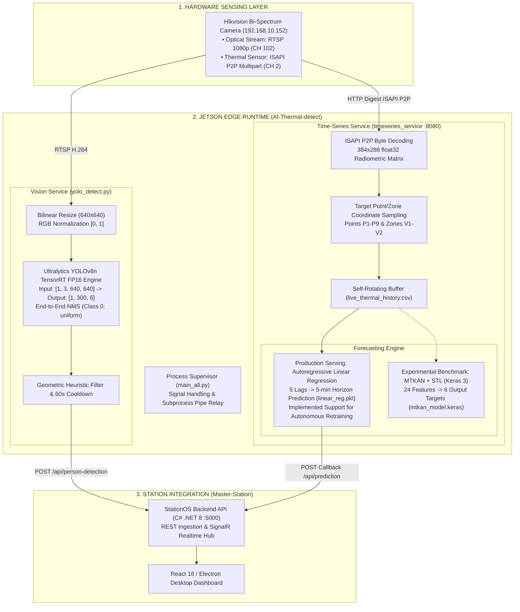
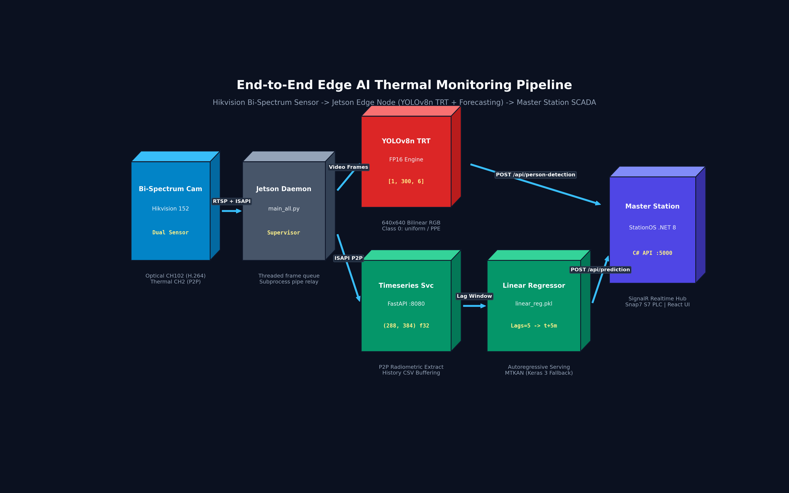
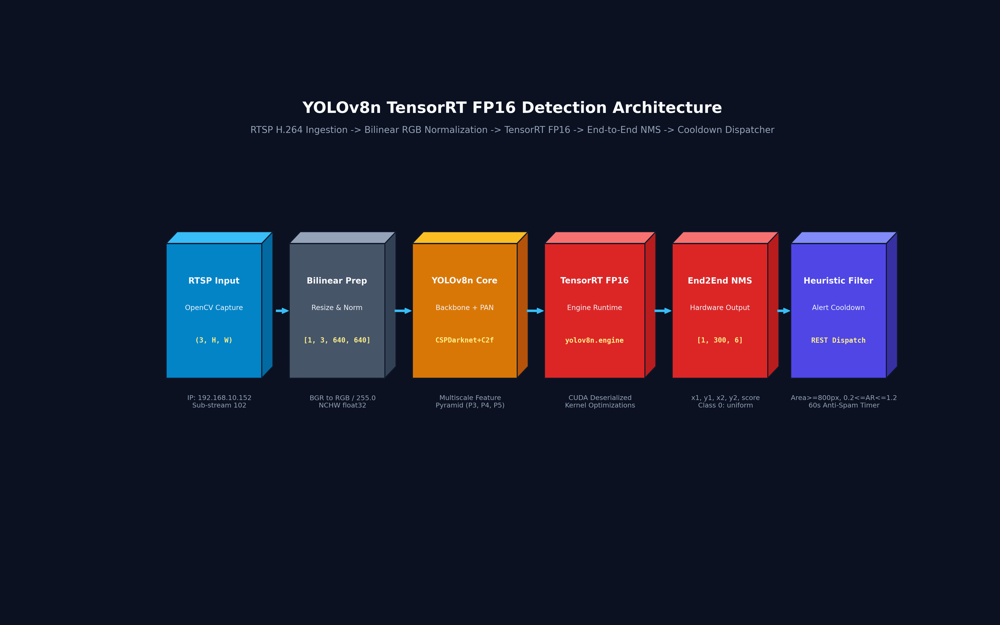
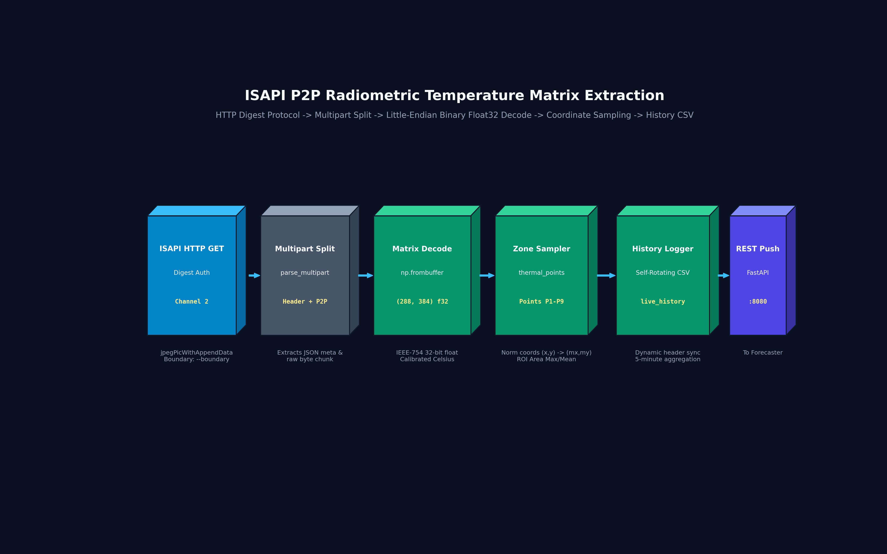
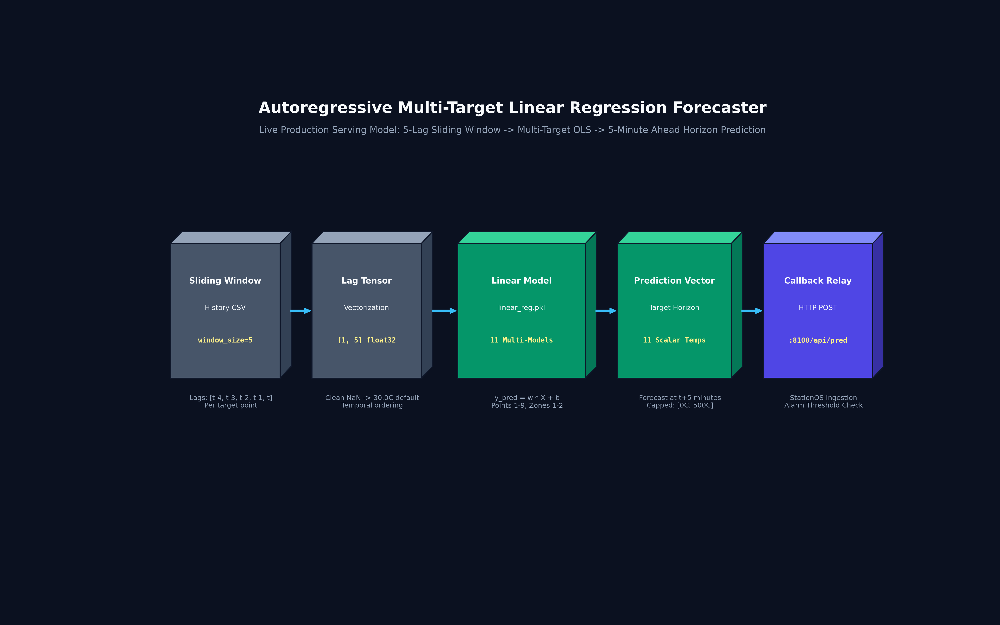
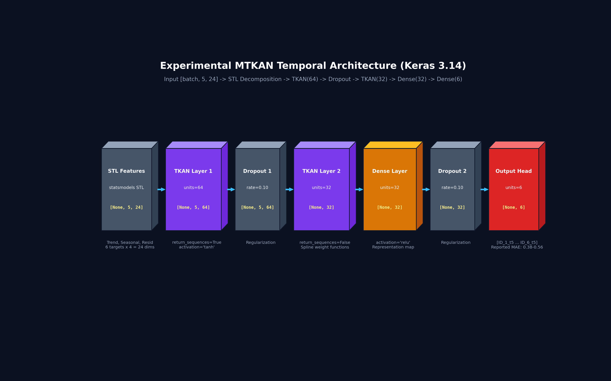
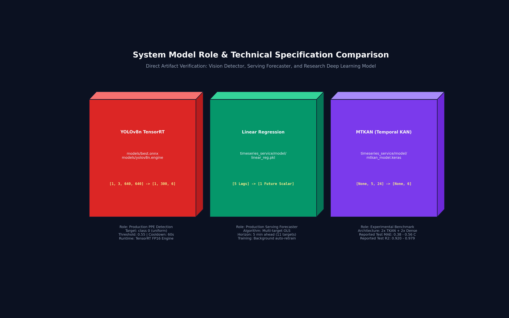
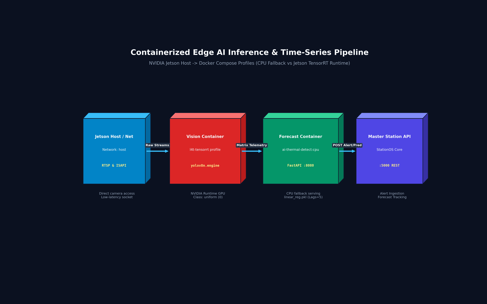

# Edge Thermal PPE Monitoring & Multi-Target Temperature Forecasting Platform
### A Dual-Daemon Edge AI System on NVIDIA Jetson with TensorRT Acceleration, Radiometric Matrix Sampling, and Autoregressive Time-Series Forecasting

[](https://developer.nvidia.com/embedded/jetson-modules)
[](https://ultralytics.com)
[](https://fastapi.tiangolo.com)
[](https://www.python.org/)
[](LICENSE)

---

## 1. Project Positioning & Scope

> **Important Notice on Architectural Scope & Verified Artifacts:**  
> This repository houses the **Edge AI & Time-Series Forecasting Core** for an industrial thermal monitoring ecosystem. It runs as a multi-process headless daemon on **NVIDIA Jetson** boards, ingesting dual optical/thermal streams from Hikvision bi-spectrum cameras and pushing structured alerts to an on-premise SCADA management system (**Master-Station**).  
> 
> **System Boundaries & Ecosystem Linkages:**
> - **[`Get-Thermal-Jetson-nano`](https://github.com/neitpm/Get-Thermal-Jetson-nano)**: Provides embedded sensing, handling raw ISAPI HTTP Digest handshakes and decoding binary multipart P2P payloads into calibrated float32 matrices.
> - **[`Master-Station`](https://github.com/neitpm/Master-Station)**: On-premise central station backend (C# ASP.NET Core .NET 8, SignalR) and desktop operator interface (React 18 + Electron) for electrical single-line diagrams (SLD) and multi-camera orchestration.
> - **[`Power-Monitor`](https://github.com/neitpm/Power-Monitor)**: Dedicated desktop thick-client distribution of the Master-Station platform.

---

## 2. Comparative Model & System Architecture

The edge runtime deploys a dual-daemon topology managed by a supervisor process (`main_all.py`), separating high-frequency visual detection from periodic thermal forecasting:



---

## 3. High-Resolution 3D Volumetric Architecture Figures

Below is the complete suite of isometric 3D volumetric tensor block diagrams illustrating layer boundaries, data formats, and mathematical tensor shapes:

#### Figure 1: 3D Volumetric End-to-End Thermal Pipeline
*Volumetric tensor progression from dual-sensor camera capture, through Jetson edge daemons, to the Master Station SCADA server.*


#### Figure 2: YOLOv8n TensorRT FP16 Detection Architecture
*RTSP H.264 ingestion, bilinear RGB normalization, TensorRT FP16 engine execution, hardware-accelerated End-to-End NMS, and 60-second cooldown dispatching.*


#### Figure 3: ISAPI P2P Radiometric Temperature Matrix Extraction
*MIME boundary demuxing, raw byte parsing into calibrated 384×288 float32 Celsius grids, and normalized coordinate target sampling.*


#### Figure 4: Autoregressive Multi-Target Linear Regression Forecaster
*Live production serving architecture: 5-lag historical sliding window, multi-target ordinary least squares regression, and 5-minute future horizon estimation.*


#### Figure 5: Experimental MTKAN Neural Network Architecture
*Detailed layer topology of `mtkan_model.keras` (Keras 3.14): STL decomposition features, dual TKAN recurrent spline layers, and multi-target output projection.*


#### Figure 6: System Model Role & Specification Comparison
*Direct artifact verification matrix comparing vision detection, live serving regression, and the experimental temporal KAN research model.*


---

## 4. Subsystem Pipelines & Model Specifications

### A. PPE / Uniform Detection Pipeline (YOLOv8n TensorRT)

The vision detection service operates headlessly without GUI dependencies to maximize throughput on Jetson hardware:
- **Model Specification:** **Ultralytics YOLOv8n** (`DetectionModel`).
  - *Checkpoint Evidence:* Verified via `models/best.onnx` metadata (`version: 8.4.38`, `imgsz: [640, 640]`, `stride: 32`, `names: {0: 'uniform'}`, `end2end: True`).
- **Inference Runtime:** Precompiled **TensorRT FP16 Engine** (`models/yolov8n.engine`, `models/best.engine`).
- **Input Dimensions:** `[1, 3, 640, 640]` float32 contiguous array in RGB format.
- **Output Tensor:** `[1, 300, 6]`, where each anchor prediction represents:
  $$\text{Box} = \left[ x_1, y_1, x_2, y_2, \text{confidence}, \text{class\_id} \right]$$
  *(Output includes embedded hardware-accelerated NMS filtering; `class_id = 0` corresponds to verified dataset class `uniform`).*
- **False-Positive Mitigation:**
  - Confidence thresholding: $\text{conf} \ge 0.55$.
  - Spatial aspect ratio constraint: $0.20 \le \frac{W}{H} \le 1.20$.
  - Minimum area filter: $W \ge 20\,\text{px}$, $H \ge 40\,\text{px}$, $\text{Area} \ge 800\,\text{px}^2$.
  - Alert Cooldown: 60-second minimum interval per camera stream to prevent redundant alerts.

---

### B. Thermal Temperature Time-Series Forecasting Pipeline

Rather than relying solely on scalar thresholds, the system extracts dense radiometric temperature matrices and models future thermal trends:
1. **Radiometric Extraction:**
   - Raw binary buffers are polled from `/ISAPI/Thermal/channels/2/thermometry/jpegPicWithAppendData`.
   - The embedded binary chunk is parsed via `np.frombuffer(raw_data[:p2p_len], dtype=np.float32)` and reshaped to **$(288, 384)$**.
   - Target coordinates configured via `thermal_points.json` are mapped onto the matrix to query true Celsius readings.
2. **Dynamic History Schema:**
   - Samples are appended to `live_thermal_history.csv`.
   - The service automatically detects newly registered measurement zones and expands CSV headers without historical data loss.

---

### C. Production vs. Experimental Forecasting Models

#### 1. Production Serving Model: Autoregressive Linear Regression (`linear_reg.pkl`)
- **Framework:** Scikit-Learn `LinearRegression` (stored via `joblib`).
- **Design Philosophy:** Low-latency, deterministic execution requiring minimal memory on edge devices.
- **Input Space:** Sliding window of 5 consecutive historical observations ($t-4, t-3, t-2, t-1, t$).
- **Output:** Scalar temperature prediction at forecast horizon $t + 5\text{ minutes}$.
- **Autonomous Retraining Support:** `train.py` contains support for background execution every 2 days (172,800 seconds). Once retrained, weights can be hot-swapped into RAM without API downtime.

#### 2. Experimental Benchmark: MTKAN (Temporal Kolmogorov-Arnold Network) (`mtkan_model.keras`)
- **Framework:** TensorFlow / Keras 3.14 (`Sequential`).
- **Feature Engineering:** STL (Seasonal-Trend decomposition using LOESS) splits each target series into **Trend**, **Seasonal**, and **Residual** components, expanding 6 raw series into a **24-dimensional feature vector**.
- **Network Topology:**
  $$\text{Input}(5, 24) \longrightarrow \text{TKAN}(64, \text{return\_seq}=\text{True}) \longrightarrow \text{Dropout}(0.1) \longrightarrow \text{TKAN}(32) \longrightarrow \text{Dense}(32, \text{ReLU}) \longrightarrow \text{Dense}(6)$$
- **Role:** Maintained as an offline research benchmark for complex non-linear seasonal thermal phenomena.

---

## 5. Empirical Evaluation & Verification Matrix

### Reported Test Metrics for MTKAN (from `metrics_test.csv`)
Evaluation metrics recorded on test split (`timeseries_service/model/metrics_test.csv`):

| Target Identifier | Mean Absolute Error (MAE) | Root Mean Squared Error (RMSE) | Coefficient of Determination ($R^2$) |
| :--- | :---: | :---: | :---: |
| **`ID_1`** | **0.478°C** | 0.588°C | 0.9694 |
| **`ID_2`** | **0.400°C** | 0.502°C | 0.9794 |
| **`ID_3`** | **0.508°C** | 0.649°C | 0.9551 |
| **`ID_4`** | **0.560°C** | 0.668°C | 0.9203 |
| **`ID_5`** | **0.435°C** | 0.554°C | 0.9700 |
| **`ID_6`** | **0.377°C** | 0.471°C | 0.9619 |
| **Average** | **0.460°C** | **0.572°C** | **0.9593** |

> [!NOTE]  
> **Detection Checkpoint Disclosure:**  
> Detection checkpoint is included (`best.pt`, `best.onnx`, `yolov8n.engine`), but the original training dataset and official validation logs are not included in this repository.

---

## 6. Edge-to-Station Integration Topology

### Communication Contracts
1. **Safety Violation Alert:**
   - `POST http://<master_ip>:5000/api/person-detection`
   - Payload: `{"timestamp": "...", "camera_ip": "192.168.10.152", "person_count": 1, "boxes": [{"x1": 100, "y1": 120, "x2": 250, "y2": 400, "score": 0.89}]}`
2. **Thermal Forecast Ingestion:**
   - `POST http://<master_ip>:8100/api/prediction`
   - Payload: `{"issued_at": "...", "forecast_timestamp": "...", "ID_1_pred": 42.5, "ID_2_pred": 38.1, ...}`

---

## 7. Reproducible Inference & Quick Start

### A. Environment Setup
```bash
# Clone repository
git clone https://github.com/neitpm/AI-Thermal-detect.git
cd AI-Thermal-detect

# Install Vision / TensorRT runtime dependencies
pip install opencv-python requests pycuda onnxruntime

# Set up isolated virtual environment for forecasting engine
cd timeseries_service
python3 -m venv tf_env
source tf_env/bin/activate
pip install -r ../requirements.txt
# Install Jetson-compatible TensorFlow / Keras 3
pip install tensorflow
deactivate
cd ..
```

### B. Verification Smoke Tests

#### 1. Validate ONNX Inference via Python
```python
import onnxruntime as ort
import numpy as np

session = ort.InferenceSession("models/best.onnx")
dummy_input = np.random.randn(1, 3, 640, 640).astype(np.float32)
outputs = session.run(None, {"images": dummy_input})
print("ONNX Output Shape:", outputs[0].shape)  # Expected: (1, 300, 6)
```

#### 2. Execute Full Edge Daemon
```bash
# Start dual daemon (Vision Detector + Thermal Forecasting Service)
python3 main_all.py

# Or run thermal forecasting service only
python3 main_all.py --thermal-only
```

---

## 8. Docker Architecture & Container Deployment

#### Figure 7: Containerized Edge AI Inference & Time-Series Pipeline
*NVIDIA Jetson Host runtime separation: CPU fallback forecasting container vs Jetson TensorRT GPU profile.*


The repository provides production Docker and Compose profiles separating lightweight CPU time-series forecasting from GPU-accelerated TensorRT inference.

### A. Environment Variables
| Variable | Default Value | Description |
|---|---|---|
| `API_PORT` | `8080` | Internal and published port for the FastAPI thermal receiver |
| `HORIZON` | `5` | Forecast horizon in minutes for future temperature prediction |
| `MODEL_DIR` | `/app/timeseries_service/model` | Path to serialized model artifacts (`linear_reg.pkl`, scalers) |
| `DATA_DIR` | `/app/timeseries_service/data` | Path to persistent storage for historical and predicted CSVs |
| `PREDICTION_CALLBACK_URL` | `http://master-station:8100/api/prediction` | Destination webhook URL on Master-Station |

### B. CPU Profile Quickstart (FastAPI + Linear Regression)
```bash
# 1. Validate Docker Compose configuration
docker compose config

# 2. Build and start the containerized service in background
docker compose up -d --build

# 3. Verify running service status and healthcheck
docker compose ps

# 4. Query live healthcheck endpoint
curl -fsS http://localhost:8080/health
# Response: {"status":"ok"}

# 5. Run Python Docker container smoke test
python scripts/docker_smoke_test.py

# 6. Stop and remove container
docker compose down
```

### C. NVIDIA Jetson Profile Quickstart (TensorRT GPU)
For NVIDIA Jetson Orin Nano / Jetson Nano running JetPack with the NVIDIA Container Runtime:
```bash
# Start Jetson TensorRT profile with host networking
docker compose -f docker-compose.jetson.yml up -d
```

---

## 9. Limitations & Scope Disclosure

1. **Detection Dataset & Benchmarking:** Detection checkpoint is included, but the original training dataset and official validation logs are not included in this repository. Target framerates vary by hardware configuration and power modes (`nvpmodel`).
2. **Model Roles:** Production serving uses autoregressive Linear Regression (`linear_reg.pkl`) for minimal latency; MTKAN represents an experimental benchmark model.
3. **Container Hardware Boundaries:** TensorRT GPU execution requires the NVIDIA Container Toolkit (`--runtime=nvidia`) and JetPack-compatible L4T base images. On x86/ARM without NVIDIA GPUs, the container gracefully falls back to CPU Linear Regression and ONNX Runtime.
4. **Thermal Scope:** The forecasting pipeline predicts continuous temperature trajectories; operational threshold anomaly scoring is handled downstream by Master-Station rule engines.

